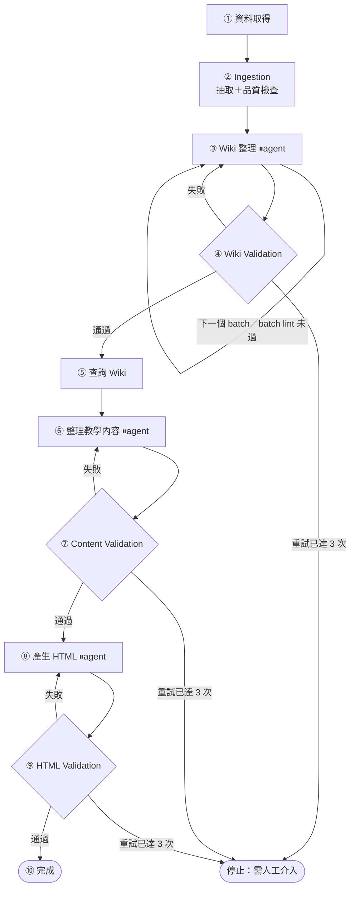

# 用 LLM Wiki 做一份教學 HTML 簡報：Cryptography 101

> 繳交標題：【學校】【學號】【系級】【姓名】Cryptography（← 請自行填入）

---

## 1. LLM Wiki 主題與簡介

**主題：Cryptography：從古典密碼到現代密碼學**

這份 Wiki 採用 Karpathy 提出的 LLM Wiki 三層模式：

| 層 | 內容 |
|---|---|
| 原始資料 | `Wiki/raw/`：15 篇來源的原始檔與抽取文字，不可修改，並記錄 SHA-256 |
| Wiki 頁面 | 22 個概念節點（`Wiki/concepts/`）、15 個來源頁（`Wiki/sources/`）、知識地圖（`knowledge_map.md`）、關鍵事實表（`facts.json`） |
| 規範 | `Wiki/WIKI_SCHEMA.md`：頁面格式、引文格式、關聯型別、撰寫原則 |

另外有 `Wiki/log.md`，按時間記錄每次 ingest、organize、lint、query 操作，只追加不修改。

依「先討論、後生成」的方式建立：
1. 先與使用者討論架構、來源與設計取捨，例如是否採用三層模式、是否補充 TLS 1.3 與 GCM 的來源以避免過時說法。
2. 確認後分 5 批（依 5 個主題）ingest 並整理。
3. 依使用者回饋，再新增第 6 批：基礎工具（位元、XOR、mod）與「別人怎麼介紹加密」（大學教科書、入門書、Cloudflare）。

| 主題 | 知識節點 |
|---|---|
| T1 Introduction | 密碼學定義與四大目標、基本術語、Kerckhoffs 原則 |
| T2 Classical | Caesar、替換密碼（含 Vigenère）、換位密碼、古典密碼的限制 |
| T3 Symmetric | 對稱式加密與金鑰分配問題、區塊與串流加密、AES |
| T4 Block Cipher Modes | 操作模式總覽、ECB、CBC、CTR、GCM（AEAD） |
| T5 Asymmetric & Apps | 公開金鑰、Diffie–Hellman 金鑰交換、RSA、數位簽章、TLS 1.3 |
| T6 基礎工具與教學法 | 位元／位元組／十六進位／XOR／mod；三種教材的介紹順序與本簡報的教學原則 |

**可追溯性：**
- 每個概念頁的重點都標註 `[來源 頁碼]`。
- 「來源引文」段落附上原文的逐字摘錄，共 **279 條**。每一條都由 Wiki Validation 自動回原文的標示頁碼比對。
- AES 頁收錄 FIPS 197 附錄 B 的完整第 1 輪實例（每一步的 4×4 state），並用獨立的 AES 實作重算驗證。
- 舊來源中的過時說法也有處理，例如 1996 年 HAC 稱 DES 仍是標準、1978 年 RSA 論文建議的金鑰長度。這些都標為「常見誤解」，並以 NIST 現行文件校正。

## 2. LLM Wiki 連結與 Ingestion 資料

- **Wiki 網頁版**：https://claude.ai/artifact/SCiXqedGNAPp2LiTjVErjf（可瀏覽全部 41 頁，含知識地圖、來源頁與操作紀錄）
- **Wiki 原始檔**：`Cryptography_Project/Wiki/`（Markdown，可用 VS Code 或 Obsidian 開啟）

**成功 ingest 15 篇資料**（作業要求至少 5 篇）。完整清單見 `Wiki/sources.md`，包含 SHA-256 與對應節點。

| ID | 標題 | 網址 | 用途 |
|---|---|---|---|
| S01 | RFC 4949: Internet Security Glossary, Version 2 | https://www.rfc-editor.org/rfc/rfc4949.txt | 標準術語定義 |
| S02 | Handbook of Applied Cryptography, Ch.1 Overview of Cryptography | https://cacr.uwaterloo.ca/hac/about/chap1.pdf | 大學教材：基本概念、古典密碼、對稱與公開金鑰 |
| S03 | Handbook of Applied Cryptography, Ch.7 Block Ciphers | https://cacr.uwaterloo.ca/hac/about/chap7.pdf | 古典密碼的弱點、操作模式性質 |
| S04 | FIPS 197 (Update 1): Advanced Encryption Standard | https://nvlpubs.nist.gov/nistpubs/FIPS/NIST.FIPS.197-upd1.pdf | AES 參數的權威來源 |
| S05 | NIST SP 800-38A: Block Cipher Modes of Operation | https://nvlpubs.nist.gov/nistpubs/Legacy/SP/nistspecialpublication800-38a.pdf | ECB／CBC／CTR、IV 與計數器要求 |
| S06 | NIST SP 800-175B Rev.1: Cryptographic Mechanisms | https://nvlpubs.nist.gov/nistpubs/SpecialPublications/NIST.SP.800-175Br1.pdf | 對稱與非對稱機制的現行觀點 |
| S07 | Diffie & Hellman (1976), New Directions in Cryptography | https://ee.stanford.edu/~hellman/publications/24.pdf | 公開金鑰與金鑰交換的原始論文 |
| S08 | Rivest, Shamir, Adleman (1978), RSA | https://people.csail.mit.edu/rivest/Rsapaper.pdf | RSA 原理與論文中的小例子 |
| S09 | RFC 8017: PKCS #1 v2.2 | https://www.rfc-editor.org/rfc/rfc8017.txt | RSA 現行規格（OAEP、PSS） |
| S10 | RFC 8446: TLS 1.3 | https://www.rfc-editor.org/rfc/rfc8446.txt | HTTPS 背後的協定 |
| S11 | NIST SP 800-38D: GCM and GMAC | https://nvlpubs.nist.gov/nistpubs/Legacy/SP/nistspecialpublication800-38d.pdf | 認證加密，銜接 CTR 與 TLS |
| S12 | NIST SP 800-57 Part 1 Rev.5: Key Management | https://nvlpubs.nist.gov/nistpubs/SpecialPublications/NIST.SP.800-57pt1r5.pdf | 現行金鑰強度對照 |
| S13 | Rosulek, The Joy of Cryptography（Oregon State University 大學部教科書） | https://joyofcryptography.com/pdf/book.pdf | mod、XOR 的定義；大學課程的教學順序 |
| S14 | Van Houtven, Crypto 101（入門書） | https://www.crypto101.io/Crypto101.pdf | XOR 的白話定義；入門書的主題順序 |
| S15 | Cloudflare Learning Center: What is encryption? | https://www.cloudflare.com/learning/ssl/what-is-encryption/ | 業界如何用白話介紹加密 |

## 3. 教學 HTML 簡報

- **線上版**：https://claude.ai/artifact/BfuUJsmQLUdTiu6bDrQuYm
- **檔案**：`Cryptography_Project/Slides/index.html`（單一檔案，直接用瀏覽器開啟，不需要伺服器）

**簡報資訊：**
- 標題：Cryptography 101：密碼學如何保護我們的資訊？
- 目標讀者：沒有密碼學背景的初學者
- 共 **35 張、6 章**。作業建議約 10～12 張；依使用者回饋「每個主題的來龍去脈要講清楚，不要擠在一兩頁」「多一些起承轉合，章與章切換要提醒」擴充。
- 第 2～6 章開頭各有一張**承上啟下的轉場頁**：剛剛學到（回顧）→ 但是……（上一章留下的新問題）→ 這一章會看到（預告）。例如 AES 之後：「一張約 1 MB 的照片要切成 65,536 塊，每一塊怎麼加密？」再進入操作模式。
  - 開場：封面、路線圖
  - 第 1 章 基礎觀念：為什麼需要 → 基本名詞 → Kerckhoffs 原則 → mod 與 XOR
  - 第 2 章 古典密碼：Caesar → 替換 → 多表替換（Vigenère）→ 換位 → 怎麼被破解
  - 第 3 章 對稱式加密：原理 → 好處與難題 → 區塊／串流 → 位元與位元組 → AES 概觀 → 四個步驟 → 逐步實例 → 解密與應用
  - 第 4 章 操作模式：為什麼需要（ECB 的問題）→ CBC → CTR 與 GCM
  - 第 5 章 公開金鑰加密：為什麼需要 → Diffie–Hellman → RSA 產生金鑰 → RSA 加解密 → 數位簽章
  - 第 6 章 綜合應用：HTTPS 與 TLS 1.3；最後是總結（「每一章解決了什麼問題」的問題→解法鏈）與參考資料

**教學設計（依使用者回饋與 Wiki 的「別人怎麼教」整理）：**
- **名詞先解釋**：每個名詞第一次出現時，同一頁就有「名詞小卡」說明（例如 mod、XOR、IV、S-box、round key、互質）。
- **公式逐一說明符號，並用正式的數學排版**：公式以 LaTeX 撰寫、產生時轉成 MathML（瀏覽器原生的數學排版，有上標、下標、分數），旁邊的符號表列出 M、C、e、d、n 各代表什麼。
- **每個主題講完來龍去脈**：原理 → 為什麼需要／好處與限制 → 現實中怎麼做。
- **圖片只標名稱**；來源統一放在最後一張「參考資料」。

**功能與互動示範：**
- 上一頁／下一頁按鈕、← → 鍵、Home／End、手機滑動、頁碼與進度條、全螢幕（按鈕或 F 鍵）、淺色與深色主題
- Caesar 加密／解密切換與位移滑桿
- AES-128 第 1 輪逐步圖解（官方範例數字，加密 6 步＋解密 4 步）
- ECB 與 CBC 加密同一張圖的對照、CBC 加密／解密流程分頁
- Diffie–Hellman 與 RSA 小數字範例

**Wiki 與簡報的對應：** 92 個重點都標註了 Wiki 節點與頁碼（在 `Workflow/artifacts/slide_content.json`），22 個節點全部用到；各頁對應見 `Wiki/knowledge_map.md` 最後一節。

## 4. Loop／Graph 設計

這份 Workflow 用 **LangGraph 實際建立並執行**（`Workflow/graph.py`，SQLite checkpoint 可跨程序暫停和繼續）。詳細說明見 `Workflow/workflow.md`。



**節點分工：**
- 程式節點（①②④⑤⑦⑨）自動執行。
- Agent 節點（③⑥⑧）由 LangGraph `interrupt` 暫停，交給 Claude Code agent 完成後繼續。
- 每個迴圈最多重試 3 次。

**三個檢查節點都是程式，不讓 LLM 自己打分數：**

| 檢查節點 | 主要檢查 | 失敗時退回 |
|---|---|---|
| ④ Wiki Validation | 資料取得是否成功；20 個節點與 56 個必要術語是否齊全；**每條引文都要在原文標示頁碼逐字找到**；連結與關聯是否完整；是否重複；事實是否與事實表矛盾、是否含常見誤解 | ③ Wiki 整理 |
| ⑦ Content Validation | 每個重點都有 Wiki 節點且來自查詢結果；數值與事實表一致；範例由程式重算；依知識圖檢查教學順序；文字量上限 | ⑥ 內容生成 |
| ⑨ HTML Validation | 用 Playwright 驅動 Edge 實際開啟。檢查 console 錯誤、內容完整、按鍵與按鈕切換、頁碼與進度條、全螢幕、1280×720 與手機排版、互動示範，並逐頁截圖 | ⑧ HTML 生成 |

**哪些步驟會重複：**
- Wiki 整理會重複：逐 batch 處理、batch lint 未過，或驗證失敗時。
- 內容生成與 HTML 生成在對應的檢查失敗時重複。

**為什麼這樣設計：** 錯誤在哪一層發生就退回哪一層修正。檢查規則都在生成之前先寫好，避免先生成內容、再配合內容放寬規則。

## 5. 實際執行結果與檢查紀錄

完整紀錄：`Workflow/execution_log.md`（由 `logs/events.jsonl` 自動產生）。各次驗證的原始結果在 `Workflow/logs/`，截圖在 `Workflow/screenshots/`。

### run-01（Workflow v1）

| 節點 | 結果 |
|---|---|
| ① 資料取得 | 12 篇全部 HTTP 200，每篇都是第 1 次下載就成功 |
| ② Ingestion | 12 篇都抽出文字、預期關鍵字都有找到，判定通過。**但事後發現漏掉 S04 的連字遺失**（見下方反思） |
| ③ Wiki 整理 | 5 個 batch，產出 20 個概念頁、12 個來源頁、17 個事實 |
| ④ Wiki Validation | **第 1 次失敗**：236 條引文中有 1 條找不到，原因是跨頁引文中間夾著 NIST 頁首。拆成兩條後，**第 2 次通過** |
| ⑤ 查詢 Wiki | 12 張投影片都有命中節點 |
| ⑦ Content Validation | 第 1 次通過（12 張、45 個重點、20 個節點） |
| ⑨ HTML Validation | 第 1 次通過（7 大類檢查 0 錯誤，全螢幕實際啟動） |
| Graph 結束後，人工看截圖 | **發現自動測試漏掉的 2 個問題**：ECB 示範圖兩色太接近，看不出輪廓；DH 表格斷行 |

### run-02（Workflow v2：修改後重新執行）

| 節點 | 結果 |
|---|---|
| ② Ingestion | 新的品質檢查**在 ingest 階段就自動標出** S04 有 77 個連字遺失的症狀字 |
| ④ Wiki Validation | 第 1 次通過（20 個概念頁、12 個來源頁、237 條引文、17 個事實，0 錯誤 0 警告） |
| ⑦ Content Validation | 第 1 次通過 |
| ⑨ HTML Validation 第 1 次 | **失敗**：ECB 對比只有 1.06:1。這一次刻意不修改 HTML 就送測，目的是確認新檢查能抓到問題 |
| ⑨ HTML Validation 第 2 次 | **失敗**：1.94:1 |
| ⑨ HTML Validation 第 3 次 | **通過**：9.03:1。用掉 3 次重試中的 2 次 |

### run-03（依使用者回饋修改簡報）

使用者要求刪除投影片上每個重點後面的頁碼標籤（例如「S02 p.2」），共 67 個。頁碼對應仍保留在教學內容檔與 Wiki。修改後經 HTML Validation 重新測試，第 1 次就通過。

### run-04（依使用者回饋：加密／解密要有更多圖解，AES 四步要有具體實例）

| 節點 | 結果 |
|---|---|
| ③ Wiki 整理 | `sym-aes` 加入 FIPS 197 附錄 B 第 1 輪實例與解密方向；`mode-cbc` 和 `mode-ctr` 加入解密公式。共新增 17 條引文，2 個事實。數值先用獨立的 AES 參考實作重算，與附錄 B 全部一致 |
| ④ Wiki Validation | 第 1 次通過（254 條引文） |
| ⑦ Content Validation 第 1 次 | **失敗 2 個錯誤**。這次是**驗證器誤判**：圖說「AES-128 第 1 輪」的「第 1 輪」是序數，C3 卻當成「總共 1 輪」。內容沒有錯，所以修正的是驗證器（排除「第 N 輪」），並重跑自我測試確認仍是 13/13 |
| ⑦ Content Validation 第 2 次 | 通過 |
| ⑨ HTML Validation 第 1 次 | **失敗**：第 8 張內容溢出。CSS 的 `display:flex` 蓋過了 `hidden` 屬性，4 個分頁同時顯示。同時發現測試漏洞：H7 只看 `hidden` 屬性，沒看實際是否顯示，已修正 |
| ⑨ HTML Validation 第 2 次 | 通過：AES 10/10 步的畫面數值正確，Caesar 解密正確，4 個分頁一次只顯示一個 |
| Graph 結束後，人工看截圖 | 再發現 3 個問題：手機版 AES 頁內容蓋住來源欄；`①②③④` 在等寬字型中看起來像 ⊕；Caesar 字母列的 X、Y、Z 被擠出畫面 |

### run-05（把截圖發現的問題變成自動檢查）

| 節點 | 結果 |
|---|---|
| ⑨ HTML Validation 第 1 次 | 新增的「內容不得與來源欄重疊」檢查用**未修改**的 HTML 送測，結果抓到 **10/12 張**在手機上重疊。這是 run-01 就存在的潛在問題：run-01 只截了 4 張手機圖，那幾張剛好沒重疊 |
| ⑨ HTML Validation 第 2 次 | 修正窄螢幕排版、按鈕字型、字母列寬度後通過；人工截圖確認 3 個問題都已解決 |

### run-06（中止）與 run-07（依使用者回饋重做：30 張、名詞先解釋、看別人怎麼教）

| 節點 | 結果 |
|---|---|
| ① 資料取得（run-06） | **S15（Cloudflare）下載失敗**：Cloudflare 擋下 Python 的 HTTP 用戶端（403），網路重試 3 次都一樣。這不是 Wiki 整理能修的問題，所以中止 run-06，修正取得節點（失敗時改用 curl 備援） |
| ① 資料取得（run-07） | 15 篇全部取得，S15 由 curl 備援取得 |
| ③ batch 6 快速檢查 | **第 1 次未過**：3 條引文太短（少於 20 字元）。這是 v2 的 batch 快速檢查第一次在實際執行中攔下問題，修正後通過 |
| ④ Wiki Validation | 第 1 次通過（22 節點、15 來源頁、279 條引文） |
| ⑤ 查詢 Wiki | **流程順序錯誤**：查詢時大綱還是舊的 12 張，更新 30 張大綱後重新查詢並記錄 |
| ⑦ Content Validation 第 1 次 | **失敗 3 個**：1 個真的內容錯誤（引用的節點不在該頁查詢結果中）；2 個新檢查 C7 的誤判（「輪流」被當成名詞「輪」、「CAESAR」含有字母 AES） |
| ⑦ Content Validation 第 2 次 | 通過（30 張、92 個重點） |
| ⑨ HTML Validation 第 1 次 | **失敗 5 個**：4 張投影片右欄公式表＋圖太高；1 個 H8 誤判（相鄰兩個標籤的文字黏成「公開金鑰」） |
| ⑨ HTML Validation 第 2 次 | 通過：AES 10/10 步正確，桌機與手機都沒有溢出 |

### run-08（依使用者回饋：公式要用正常的數學排版）

| 節點 | 結果 |
|---|---|
| ⑦ Content Validation | 10 個公式加上 LaTeX 後第 1 次通過（C8 新增：每個公式都要有可轉換的 LaTeX） |
| ⑨ HTML Validation 第 1 次 | 【刻意驗證】用未修改的 HTML 送測，新檢查抓到 10 個公式沒排版（H2）與 5 張投影片有 `c_i`、`E_K`、`M^e` 這類寫法（H9） |
| ⑨ HTML Validation 第 2 次 | 改用 MathML 排版、圖中改成真正的上下標後通過 |

### run-09（依使用者回饋：多一些起承轉合、章與章切換要提醒）

| 節點 | 結果 |
|---|---|
| 規劃 | 先更新大綱（35 張）再讓 Graph 查詢，避免 run-07 的順序錯誤 |
| ⑦ Content Validation 第 1 次 | **失敗 3 個**：第 3、4、5 章轉場頁的標題，在下一頁解釋之前就先用了「對稱式加密」「操作模式」「公開金鑰加密」。這是真的教學順序問題，改為在轉場頁加「本章主角」名詞小卡 |
| ⑦ Content Validation 第 2 次 | 通過（C10 新增：第 2～6 章的第一張必須是轉場頁） |
| ⑨ HTML Validation | 第 1 次通過；看截圖後修正「但是……」重複與版面置中，單獨重跑仍通過 |

### Validator 自我測試（Graph 外）

在專案副本中注入 13 種已知錯誤，例如虛構引文、錯誤頁碼、事實矛盾、教學順序顛倒、缺少全螢幕按鈕。
- 第 1 次抓到 **12/13**。
- 修正 C3 後抓到 **13/13**。
- 未注入錯誤的對照組皆通過。
- run-04、run-05 修改驗證器之後重跑，仍為 13/13。
- run-07 依使用者回饋新增 C7–C10、H8 後，加入 5 個新案例：**18/18** 全部抓到。
- run-08 新增數學排版檢查後，再加 2 個案例：**20/20**。
- run-09 新增轉場頁檢查案例後第 1 次 20/21：漏掉的是一個**過時的測試案例**（固定交換第 6、7 張，加入轉場頁後不再製造錯誤），改為依 id 交換後 **21/21**。

## 6. 反思

**最常出錯的節點：**
- 以 Graph 記錄的驗證失敗次數來看，最多的是 **⑧ HTML 生成 ⇄ ⑨ HTML Validation 這個迴圈**：
  - run-02 失敗 2 次，run-04 失敗 1 次，run-05 失敗 1 次。
  - run-01 與 run-04 結束後，人工看截圖又各找到自動測試漏掉的問題。
- 但更值得注意的是另一種錯誤：**檢查節點本身也會漏掉問題**。
  - run-01 的 Ingestion 通過了，S04 的文字其實有缺字。
  - HTML Validation 通過了，示範圖其實看不清楚。
  - Content Validation 在自我測試中被發現有漏洞：「AES-128 做 12 輪」也能通過。
  - 檢查也會**過度嚴格**：加強後的 C3 把「第 1 輪」誤判為輪數錯誤（run-04）。
  - 檢查也會**看錯地方**：H7 只看 `hidden` 屬性，沒看畫面上實際顯示了什麼。
- 所以「一次就通過」不等於正確，「不通過」也不一定是內容錯。
- 最大的盲點是「**檢查的標準本身**」：名詞沒先解釋、公式符號沒說明這類問題，所有檢查都通過，直到使用者看了簡報才指出來。後來把這些回饋寫成 C7–C10 與 H8，之後就由程式把關。

**檢查往前移到了哪裡：**

| 問題 | 原本在哪裡發現 | 移到哪裡 |
|---|---|---|
| PDF 連字遺失 | ③ Wiki 整理時讀原文才發現；原本要到 ④ Wiki Validation 才會大量報錯 | **② Ingestion** |
| 跨頁引文錯誤 | ④ Wiki Validation，5 個 batch 全部寫完後 | **③ 每個 batch 寫完當下**（batch lint） |
| 示範圖對比不足 | Graph 結束後的人工截圖檢查 | **⑨ HTML Validation 的自動檢查** |
| AES 版本與輪數不對應 | Graph 外的自我測試 | **⑦ Content Validation（C3）** |
| 手機版內容與來源欄重疊（10/12 張） | run-04 結束後人工看截圖 | **⑨ HTML Validation（H6 重疊檢查）** |
| 分頁實際上全部顯示 | ⑨ 的排版檢查間接發現 | **⑨ H7 改為檢查實際顯示** |
| 名詞沒先解釋、公式符號沒說明、圖片寫來源、主題擠在一兩頁 | **使用者看簡報後的回饋**（Graph 的檢查都沒有這些規則） | **⑦ C7–C10、⑨ H8**：把回饋變成自動檢查 |
| 網站擋下 Python 的 HTTP 用戶端 | ① 取得失敗後，run-06 只能中止 | **① fetch**：自動改用 curl 備援 |

**是否修改 Workflow／Graph：** 有，升級為 v2。
- 新增 ingest 品質檢查。
- organize_wiki 內加入 batch lint。
- 新增 HTML 對比度檢查。
- 強化 C3。
- 新增 Wiki 增量模式。
- 把人工檢查和自我測試也寫進事件紀錄。

**原因：** 錯誤越晚發現，修正成本越高。檢查本身也需要被測試。
run-02 證明修改有效：同一個 ECB 問題，在 v1 只能靠人工發現，在 v2 由自動檢查擋下。

更完整的問答與個人心得見 `Report/Reflection.md`。

## 7. 檔案結構

```
Cryptography_Project/
├── Wiki/
│   ├── knowledge_map.md      知識地圖、索引、簡報對應
│   ├── sources.md            15 篇來源清單（自動產生，含 SHA-256）
│   ├── WIKI_SCHEMA.md        Wiki 規範
│   ├── log.md                Wiki 操作紀錄（只追加）
│   ├── facts.json            關鍵事實表（矛盾檢查用）
│   ├── concepts/             22 個概念節點
│   ├── sources/              15 個來源頁
│   └── raw/                  原始檔與抽取文字（僅存於本機，不公開）
├── Workflow/
│   ├── workflow.md           Graph 設計說明
│   ├── execution_log.md      實際執行紀錄（自動產生）
│   ├── graph.py              LangGraph 主程式
│   ├── validators/           wiki_lint、query、content_check、html_test、selftest、report、aes_ref
│   ├── tools/                render_slides（產生簡報）、visuals.html（每張圖）、slides_shell.html、build_wiki_viewer
│   ├── config/               來源、batch、必要術語、投影片大綱、名詞表 glossary
│   ├── artifacts/            查詢結果、教學內容 slide_content.json、Graph 原始 Mermaid 圖
│   ├── logs/                 事件紀錄與每次驗證的 JSON
│   └── screenshots/          每次 HTML 測試的逐頁截圖
├── Slides/
│   └── index.html            教學簡報（單一檔案）
└── Report/
    ├── final_report.md       本報告
    └── Reflection.md         作業問答與心得
```

**環境：** Python 3.13、LangGraph 1.2.24、langgraph-checkpoint-sqlite 3.1.3、pypdf 7.1.1、Playwright 1.65.2（Microsoft Edge）。
**限制：** 環境沒有 LLM API Key，所以生成節點由 Claude Code agent 經 `interrupt` 完成，不是 Graph 自動呼叫 LLM。
