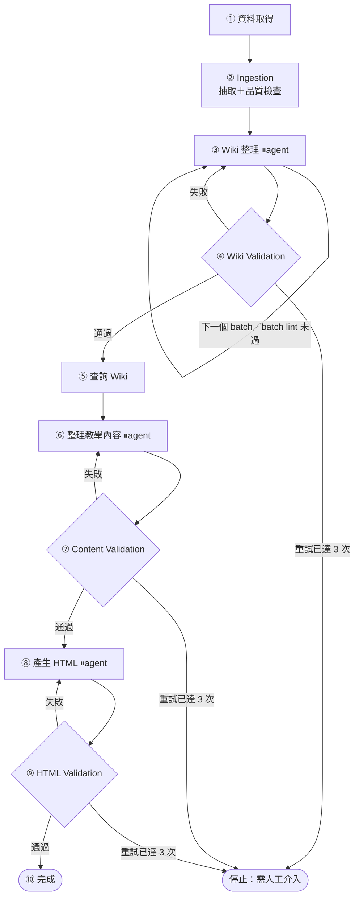

# Cryptography 101：用 LLM Wiki 製作教學 HTML 簡報

> 繳交標題：【學校】【學號】【系級】【姓名】Cryptography

## 本文件對應的作業要求

| 作業要求 | 本文件的位置 |
|---|---|
| 繳交內容 1：LLM Wiki 主題與簡短介紹 | 第 1 節 |
| 繳交內容 2：LLM Wiki 連結或成果 | 第 2 節 |
| 繳交內容 3：教學 HTML 簡報連結 | 第 3 節 |
| 繳交內容 4：loop／graph 的流程圖或文字說明 | 第 4 節 |
| 繳交內容 5：一次實際執行的結果或檢查紀錄 | 第 5 節 |
| 繳交內容 6：反思（哪個節點最常出錯？如何調整檢查流程？） | 第 6 節 |
| 步驟一：用「先討論、後生成」建立 Wiki，至少 ingest 5 篇資料 | 第 1、2 節 |
| 步驟二：用 Wiki 製作讓初學者看得懂的教學 HTML 簡報 | 第 3 節 |
| 步驟三：哪些步驟會重複執行？哪些地方需要檢查或重新生成？為什麼這樣設計？ | 第 4 節，問題 1～3 |
| 步驟四：哪個節點最常出錯？把檢查往前移到哪一步？有沒有因此修改 workflow／graph？為什麼？ | 第 6 節，問題 1～3 |

---

## 1. 〔繳交內容 1〕LLM Wiki 主題與簡短介紹（對應步驟一）

**主題：Cryptography：從古典密碼到現代密碼學**

這份 Wiki 整理密碼學從古典密碼到現代網路加密的基本知識，採用 LLM Wiki 的三層結構：

| 層 | 內容 |
|---|---|
| 原始資料 | 15 篇來源的原始檔與抽取出來的文字，記錄 SHA-256，不可修改 |
| Wiki 頁面 | 22 個知識節點、15 個來源頁、知識地圖、關鍵事實表 |
| 規範 | 頁面格式、引文格式、節點之間的關聯型別 |

**如何做到「先討論、後生成」：**

1. 先與 AI 討論 Wiki 架構、資料來源與設計取捨，例如：是否採用三層結構、是否補上 TLS 1.3 與 GCM 的來源，以免簡報出現「HTTPS 用 RSA 加密金鑰」這類過時說法。
2. 我確認後，才依主題分批 ingest 資料，並整理成知識節點。
3. 之後依我對簡報的回饋，再新增一批「基礎工具與別人怎麼介紹加密」的資料與節點。

**規模與可信度：** 6 個主題、22 個知識節點、15 篇資料。每個重點都標註來源與頁碼，並附 279 條原文逐字引文；每一條引文都由程式回原文比對，找不到就判定失敗，避免 AI 虛構內容。

## 2. 〔繳交內容 2〕LLM Wiki 連結或成果（對應步驟一）

- **Wiki 網頁版**：https://claude.ai/artifact/SCiXqedGNAPp2LiTjVErjf （可瀏覽知識地圖、22 個節點、15 個來源頁與操作紀錄）
- **Wiki 原始檔**：附件 `Wiki/` 資料夾（Markdown）

**Ingest 的 15 篇資料**（作業要求至少 5 篇；完整網址與 SHA-256 見 `Wiki/sources.md`）：

| ID | 資料 | 類型 | 用途 |
|---|---|---|---|
| S01 | RFC 4949 Internet Security Glossary | IETF 標準 | 術語定義 |
| S02 | Handbook of Applied Cryptography 第 1 章 | 大學教材 | 基本概念、古典密碼 |
| S03 | Handbook of Applied Cryptography 第 7 章 | 大學教材 | 古典密碼的弱點、操作模式 |
| S04 | FIPS 197 Advanced Encryption Standard | NIST 標準 | AES 規格與官方範例 |
| S05 | NIST SP 800-38A | NIST 標準 | ECB、CBC、CTR |
| S06 | NIST SP 800-175B | NIST 指引 | 對稱與非對稱機制的現行觀點 |
| S07 | Diffie & Hellman (1976) New Directions in Cryptography | 原始論文 | 公開金鑰與金鑰交換 |
| S08 | Rivest, Shamir, Adleman (1978) RSA 論文 | 原始論文 | RSA 原理與範例 |
| S09 | RFC 8017 PKCS #1 | IETF 標準 | RSA 現行規格 |
| S10 | RFC 8446 TLS 1.3 | IETF 標準 | HTTPS 背後的協定 |
| S11 | NIST SP 800-38D | NIST 標準 | GCM 認證加密 |
| S12 | NIST SP 800-57 Part 1 | NIST 標準 | 金鑰強度 |
| S13 | The Joy of Cryptography（Oregon State University） | 大學教科書 | mod、XOR；大學課程的教學順序 |
| S14 | Crypto 101 | 入門書 | XOR；入門教材的主題順序 |
| S15 | Cloudflare：What is encryption? | 業界說明文章 | 如何用白話介紹加密 |

## 3. 〔繳交內容 3〕教學 HTML 簡報連結（對應步驟二）

- **簡報網頁版**：https://claude.ai/artifact/BfuUJsmQLUdTiu6bDrQuYm
- **簡報檔案**：附件 `Slides/index.html`（單一檔案，直接用瀏覽器開啟，不需要伺服器）
- **標題**：Cryptography 101：密碼學如何保護我們的資訊？

**如何讓不熟悉密碼學的人看得懂：**

- 共 35 張、6 章：基礎觀念 → 古典密碼 → 對稱式加密（AES）→ 操作模式 → 公開金鑰加密（RSA）→ 綜合應用（HTTPS）。
- 每章都依「原理 → 為什麼需要／好處與限制 → 現實中怎麼做」的順序講完。
- 第 2～6 章開頭各有一張轉場頁：剛剛學到什麼 → 留下什麼新問題 → 這一章會看到什麼。
- 名詞第一次出現時，同一頁就有名詞小卡解釋，例如 mod、XOR、IV、S-box、互質。
- 公式用正式的數學排版，並逐一說明每個符號，例如 C = M^e mod n 中 C、M、e、d、n 各代表什麼。
- 互動示範：Caesar 加密／解密滑桿、AES 一輪四個步驟的逐步圖解（使用標準文件中的官方範例數字）、ECB 與 CBC 加密同一張圖的對照。
- 每個重點都對應到 Wiki 節點（92 個重點用到全部 22 個節點），來源統一列在最後一張「參考資料」。
- 支援上一頁／下一頁按鈕、左右方向鍵、頁碼與進度條、全螢幕。

## 4. 〔繳交內容 4〕Loop／Graph 設計（對應步驟三）

整個流程用 LangGraph 實際建立並執行（附件 `Workflow/graph.py`），不只是畫圖：

**文字說明：** 取得資料 → 抽取文字 → 整理成 Wiki → 檢查 Wiki → 查詢 Wiki → 整理教學內容 → 檢查內容 → 產生 HTML 簡報 → 測試 HTML → 完成。

- 程式節點（①②④⑤⑦⑨）自動執行。
- 需要寫內容的節點（③⑥⑧）會暫停，交給 AI 完成後再繼續。
- 三個檢查節點（④⑦⑨）都是程式檢查，不讓 AI 自己打分數。

### 〔步驟三・問題 1〕哪些步驟會重複執行？

| 會重複的步驟 | 什麼時候重複 |
|---|---|
| ③ Wiki 整理 | 每個主題各做一批；每批寫完的快速檢查沒過，就重做同一批；④ Wiki Validation 失敗時退回修正 |
| ⑥ 整理教學內容 | ⑦ Content Validation 失敗時退回重寫 |
| ⑧ 產生 HTML | ⑨ HTML Validation 失敗時退回重做 |
| ① 資料取得 | 網路失敗時每篇最多重試 3 次，再失敗就改用備援方式下載 |

每個「檢查 → 退回」的迴圈最多重試 3 次。超過就停下來交給人判斷，避免無限迴圈。

### 〔步驟三・問題 2〕哪些地方需要檢查或重新生成？

| 檢查點 | 檢查什麼 | 不通過時重新生成什麼 |
|---|---|---|
| ② Ingestion | 下載成功、抽出的字數足夠、關鍵字存在、PDF 有沒有缺字 | 重新抽取文字 |
| ③ 每批寫完的快速檢查 | 這一批頁面的格式與引文 | 重寫同一批 Wiki 頁 |
| ④ Wiki Validation | 資料是否取得、重要知識有無遺漏、每條引文能否在原文逐字找到、連結是否完整、有無重複、事實有無矛盾 | 修正 Wiki 頁 |
| ⑦ Content Validation | 每個重點都有 Wiki 依據、數字與事實表一致、範例由程式重算、教學順序（先備知識在前）、名詞先解釋、公式符號有說明、每章有完整的來龍去脈 | 重寫教學內容 |
| ⑨ HTML Validation | 用瀏覽器實際開啟：能否開啟、內容是否完整、換頁、頁碼與進度條、全螢幕、桌機與手機版面、互動示範、數學排版 | 重做 HTML |

### 〔步驟三・問題 3〕為什麼這樣設計？

1. **先建 Wiki，再查詢，再生成。** 簡報只能使用從 Wiki 查到的內容，所以每個重點都能追到「Wiki 節點 → 來源 → 原文頁碼」。
2. **檢查用程式，不讓 AI 自己打分數。** 引文必須能在原文逐字找到、數字必須和事實表一致、範例由程式重新計算，這些都是用來防止 AI 虛構內容。
3. **哪一層出錯就退回哪一層。** Wiki 錯就改 Wiki，內容錯就改內容，HTML 錯就改 HTML，不必整條流程重跑。
4. **重試有上限。** 避免無限迴圈，也避免為了通過而亂改。
5. **先訂檢查規則，再生成內容。** 避免先寫好內容，再配合內容放寬規則。

## 5. 〔繳交內容 5〕一次實際執行的結果或檢查紀錄

以下是第一次完整執行（run-01）各節點的實際結果。每一筆紀錄都由程式在執行當下寫入，完整紀錄見附件 `Workflow/execution_log.md`。

| 節點 | 實際結果 |
|---|---|
| ① 資料取得 | 12 篇全部下載成功（HTTP 200），記錄 SHA-256 |
| ② Ingestion | 12 篇都抽出文字，判定通過。但這一步其實漏掉了 FIPS 197 的 PDF 缺字問題（見第 6 節） |
| ③ Wiki 整理 | 分 5 批完成：20 個知識節點、12 個來源頁 |
| ④ Wiki Validation | **第 1 次失敗**：236 條引文中有 1 條找不到。原因是那段話橫跨兩頁，中間夾著頁首。退回 ③ 拆成兩條引文後，**第 2 次通過** |
| ⑤ 查詢 Wiki | 每張投影片都查到對應的節點 |
| ⑦ Content Validation | 第 1 次通過 |
| ⑨ HTML Validation | 第 1 次通過（開啟、換頁、全螢幕、版面、互動示範都正常） |
| 結束後人工看截圖 | 發現 2 個自動測試沒抓到的問題：ECB 示範圖兩個顏色太接近、看不出輪廓；一個表格斷行 |

之後依問題與回饋又執行了 8 次。每次的重點如下：

| 執行 | 原因 | 檢查結果 |
|---|---|---|
| run-02 | 驗證修改後的流程 | Ingestion 自動抓到 PDF 缺字；HTML 失敗 2 次後通過 |
| run-03 | 刪除投影片上的頁碼標籤 | HTML 第 1 次通過 |
| run-04 | 加入 AES 逐步圖解與加解密圖 | Content 失敗 1 次（檢查誤判）；HTML 失敗 1 次（分頁同時顯示）後通過 |
| run-05 | 新增手機版重疊檢查 | 抓到 10 張投影片在手機上內容重疊，修正後通過 |
| run-06 | 新增教學法資料 | 中止：一篇網頁的下載被網站擋下，修正下載方式 |
| run-07 | 依回饋重排簡報、名詞先解釋 | 每批快速檢查失敗 1 次；Content、HTML 各失敗 1 次後通過 |
| run-08 | 公式改用正式數學排版 | 先用舊版確認新檢查有效（失敗），修正後通過 |
| run-09 | 章與章之間加入轉場頁 | Content 失敗 1 次（名詞搶先使用）後通過；HTML 第 1 次通過 |

## 6. 〔繳交內容 6〕反思（對應步驟四）

### 〔步驟四・問題 1〕哪一個節點最常出錯？

**最常出錯的是「⑧ 產生 HTML ⇄ ⑨ HTML Validation」這個迴圈。** Graph 紀錄中，HTML Validation 一共失敗 6 次（其中 3 次是刻意用舊版送測，用來確認新加的檢查有效）。相比之下，Content Validation 失敗 3 次，Wiki Validation 失敗 1 次。HTML 的錯誤包括：示範圖顏色太接近、CSS 讓分頁同時顯示、手機上內容蓋住頁尾、公式沒有數學排版。

但比「哪個節點錯最多」更值得注意的是：**檢查本身也會出錯。**

- Ingestion 判定 PDF 抽取成功，實際上「fi」這兩個字母全部遺失（specified 變成 specifed）。
- HTML Validation 判定通過，但示範圖肉眼根本看不清楚。
- 名詞沒先解釋、公式沒排版這類問題，所有檢查都通過，是看了簡報之後才發現的。

### 〔步驟四・問題 2〕發現問題後，把檢查往前移到了哪一個步驟？

| 問題 | 原本在哪裡才發現 | 檢查往前移到 |
|---|---|---|
| PDF 缺字 | ③ Wiki 整理時讀原文才發現。如果沒發現，要到 ④ Wiki Validation 才會大量報錯 | **② Ingestion**：抽取文字時就自動檢查缺字 |
| 跨頁引文比對失敗 | ④ Wiki Validation，5 批全部寫完之後 | **③ 每一批寫完的當下**：立刻檢查這一批的引文 |
| 示範圖看不清楚、手機版重疊 | 流程結束後人工看截圖 | **⑨ HTML Validation**：加入對比度與版面重疊的自動檢查 |
| 名詞沒解釋、公式沒排版、章節轉折不足 | 看了簡報之後才發現 | **⑦ Content Validation 與 ⑨ HTML Validation**：寫成自動檢查規則 |

### 〔步驟四・問題 3〕有沒有因此修改 workflow／graph？為什麼？

**有。** 主要修改：

1. Ingestion 加入 PDF 缺字檢查，資料取得失敗時自動改用備援方式下載。
2. Wiki 整理改成每寫完一批就先快速檢查，沒過就重做同一批（Graph 的自我迴圈）。
3. HTML Validation 加入對比度、手機版重疊、數學排版的檢查。
4. Content Validation 加入「名詞先解釋」「公式符號要說明」「每章要有來龍去脈與轉場」等規則。
5. 用「故意注入錯誤」的方式測試檢查器本身：注入 21 種錯誤，最終全部抓到。

**為什麼：**

- **錯誤越晚發現，修正越貴。** PDF 缺字如果拖到 Wiki Validation，相關的引文會一次全部失敗；示範圖問題甚至是在流程判定「完成」之後才被發現。
- **「通過」不等於「正確」。** 檢查本身也需要被檢查，所以要用注入錯誤的方式確認它真的抓得到問題。

修改後確實有效：同樣的示範圖問題，舊流程只能靠人工發現；新流程在 HTML Validation 就自動擋下，並退回重做。

---

## 附件

| 檔案 | 內容 |
|---|---|
| `Slides/index.html` | 教學 HTML 簡報 |
| `Wiki/` | LLM Wiki 原始檔（知識地圖 knowledge_map.md、資料來源 sources.md、22 個節點、15 個來源頁） |
| `Workflow/workflow.md` | Loop／Graph 的完整設計說明 |
| `Workflow/execution_log.md` | 9 次實際執行的完整紀錄（各節點的輸入、輸出、檢查結果與修正） |
| `Workflow/graph.py` | LangGraph 主程式 |
