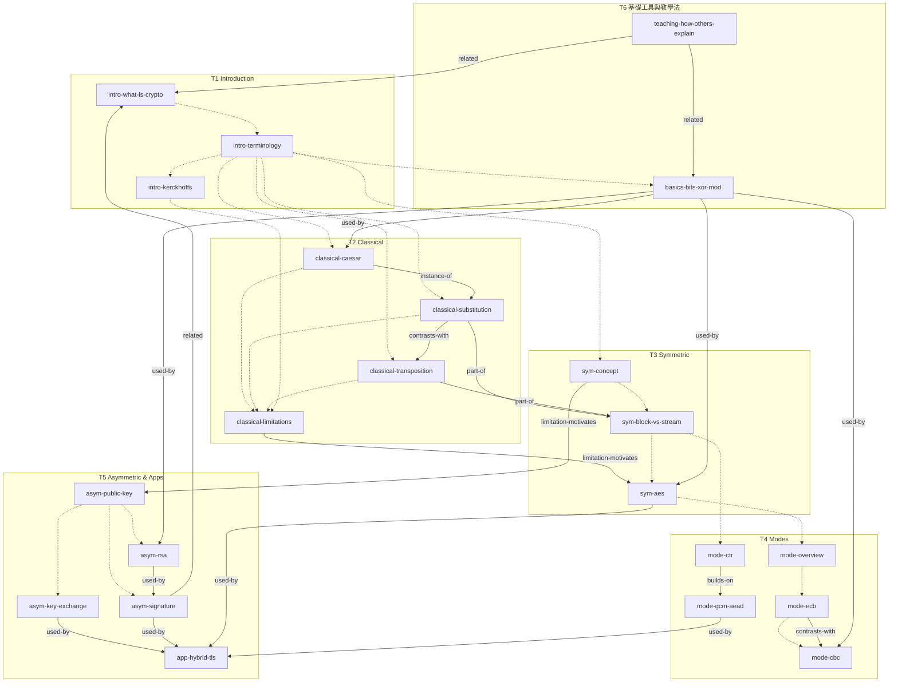

# Knowledge Map（知識地圖／索引）

> Cryptography LLM Wiki 的總索引：6 個主題、22 個概念節點、15 篇來源頁。
> 每個節點的技術敘述都標註 `[Sxx p.N]`，並在「來源引文」段落附原文逐字摘錄（由 Wiki Validation 自動比對原文）。
> 規範見 [WIKI_SCHEMA.md](WIKI_SCHEMA.md)；操作紀錄見 [log.md](log.md)；來源清單見 [sources.md](sources.md)。

## 學習路徑（初學者建議順序）

1. 為什麼需要密碼學 → 2. 基本術語與基礎工具（位元、XOR、mod）→ 3. 古典密碼與它的弱點 → 4. 對稱式加密與 AES →
5. 操作模式 → 6. 公開金鑰、金鑰交換、RSA、數位簽章 → 7. 全部組合起來：HTTPS／TLS 1.3

## 索引

### T1 Introduction to Cryptography
| 節點 | 一句話摘要 | 主要來源 |
|---|---|---|
| [[intro-what-is-crypto]] | 密碼學的定義與四大目標（機密性、完整性、鑑別、不可否認性） | S01, S02 |
| [[intro-terminology]] | 明文、密文、金鑰、加密、解密；Alice／Bob／攻擊者的通訊模型 | S01, S02 |
| [[intro-kerckhoffs]] | 演算法可公開、只有金鑰要保密；金鑰空間要大到無法暴力破解 | S01, S02 |

### T2 Classical Cryptography
| 節點 | 一句話摘要 | 主要來源 |
|---|---|---|
| [[classical-caesar]] | 每個字母位移 k 位；只有 26 把金鑰 | S02, S03 |
| [[classical-substitution]] | 換字母不換位置：單表、同音、多表（Vigenère） | S02, S03 |
| [[classical-transposition]] | 換位置不換字母：區塊內重新排列 | S02, S03 |
| [[classical-limitations]] | 金鑰空間小 → 窮舉；保留頻率 → 頻率分析 | S02, S03 |

### T3 Symmetric Encryption
| 節點 | 一句話摘要 | 主要來源 |
|---|---|---|
| [[sym-concept]] | 加解密用同一把金鑰；金鑰分配與金鑰數量問題 | S02, S06 |
| [[sym-block-vs-stream]] | 區塊加密一次一塊；串流加密用金鑰串流逐符號加密 | S02, S06 |
| [[sym-aes]] | 128 位元區塊；128／192／256 位元金鑰；10／12／14 輪 | S04, S06, S12 |

### T4 Block Cipher Modes
| 節點 | 一句話摘要 | 主要來源 |
|---|---|---|
| [[mode-overview]] | 為什麼需要操作模式；IV 與填充 | S03, S05 |
| [[mode-ecb]] | 每塊獨立加密 → 相同明文區塊產生相同密文（洩漏圖樣） | S03, S05 |
| [[mode-cbc]] | 與前一個密文區塊 XOR 鏈結；IV 必須無法預測 | S01, S03, S05 |
| [[mode-ctr]] | 加密計數器再 XOR；可平行、免填充、計數器不可重複 | S05 |
| [[mode-gcm-aead]] | CTR 變形 + 認證標籤 = 機密性 + 完整性（TLS 1.3 使用） | S05, S11 |

### T5 Asymmetric Cryptography & Applications
| 節點 | 一句話摘要 | 主要來源 |
|---|---|---|
| [[asym-public-key]] | 公鑰公開、私鑰保密；公鑰加密、私鑰解密 | S02, S06, S07 |
| [[asym-key-exchange]] | Diffie–Hellman：在公開通道上協議出共享金鑰 | S02, S07, S08, S10 |
| [[asym-rsa]] | n = p·q，C = M^e mod n；安全性來自大數分解；實務用 OAEP | S02, S08, S09, S12 |
| [[asym-signature]] | 私鑰簽章、公鑰驗證；提供完整性、鑑別、不可否認性 | S02, S06, S08, S09, S10 |
| [[app-hybrid-tls]] | TLS 1.3：(EC)DHE 交換金鑰 + 憑證簽章 + AES-GCM 加密 | S06, S10 |

### T6 教學補充：基礎工具與別人怎麼教
| 節點 | 一句話摘要 | 主要來源 |
|---|---|---|
| [[basics-bits-xor-mod]] | 位元、位元組、十六進位、XOR（相同→0、不同→1）、mod（取餘數） | S04, S08, S13, S14 |
| [[teaching-how-others-explain]] | 大學教科書、入門書、Cloudflare 怎麼介紹加密；本簡報的教學原則 | S13, S14, S15 |

### 來源頁
[[S01]] RFC 4949 · [[S02]] HAC Ch.1 · [[S03]] HAC Ch.7 · [[S04]] FIPS 197 · [[S05]] SP 800-38A · [[S06]] SP 800-175B ·
[[S07]] Diffie–Hellman 1976 · [[S08]] RSA 1978 · [[S09]] RFC 8017 · [[S10]] RFC 8446 · [[S11]] SP 800-38D · [[S12]] SP 800-57 Pt.1 ·
[[S13]] The Joy of Cryptography · [[S14]] Crypto 101 · [[S15]] Cloudflare：What is encryption?

## 知識圖

實線：概念關聯（relations）；虛線：先備知識（prerequisites）。

## 簡報對應（Wiki → Slides，35 張）

| 投影片 | 對應節點 |
|---|---|
| 1 Cryptography 101 | — |
| 2 今天的路線圖 | [[teaching-how-others-explain]] |
| 3 為什麼需要密碼學？ | [[intro-what-is-crypto]] |
| 4 密碼學在做什麼？基本名詞 | [[intro-terminology]] |
| 5 演算法可以公開，金鑰必須保密 | [[intro-kerckhoffs]] |
| 6 兩個數學小工具：mod 與 XOR | [[basics-bits-xor-mod]] |
| 7 第 2 章：古典密碼 | [[basics-bits-xor-mod]]、[[intro-kerckhoffs]] |
| 8 Caesar 密碼：每個字母往後移 k 位 | [[classical-caesar]] |
| 9 替換密碼：把整個字母表打亂 | [[classical-substitution]] |
| 10 多表替換：Vigenère 密碼 | [[classical-substitution]] |
| 11 換位密碼：字母不變，位置打亂 | [[classical-transposition]] |
| 12 古典密碼怎麼被破解？ | [[classical-limitations]] |
| 13 第 3 章：對稱式加密 | [[classical-limitations]] |
| 14 對稱式加密：同一把金鑰鎖上也打開 | [[sym-concept]] |
| 15 對稱式加密的好處與難題 | [[asym-public-key]]、[[sym-concept]] |
| 16 兩種做法：區塊加密與串流加密 | [[sym-block-vs-stream]] |
| 17 電腦裡的資料：位元、位元組、十六進位 | [[basics-bits-xor-mod]] |
| 18 現實中的對稱式加密：AES | [[sym-aes]] |
| 19 AES 每一輪的四個步驟 | [[sym-aes]] |
| 20 AES 實例：一步一步看資料怎麼變 | [[sym-aes]] |
| 21 AES 怎麼解密？現在用在哪裡？ | [[sym-aes]] |
| 22 第 4 章：操作模式 | [[sym-aes]] |
| 23 為什麼需要操作模式？先看 ECB 的問題 | [[mode-ecb]]、[[mode-overview]] |
| 24 CBC：把區塊一個接一個串起來 | [[mode-cbc]] |
| 25 CTR 與 GCM：現在網路上用的模式 | [[mode-ctr]]、[[mode-gcm-aead]] |
| 26 第 5 章：公開金鑰加密 | [[mode-gcm-aead]]、[[sym-concept]] |
| 27 為什麼需要公開金鑰加密？ | [[asym-public-key]] |
| 28 Diffie–Hellman：在公開場合約定同一把金鑰 | [[asym-key-exchange]] |
| 29 RSA（一）：怎麼產生一對金鑰 | [[asym-rsa]] |
| 30 RSA（二）：加密與解密 | [[asym-rsa]] |
| 31 數位簽章：私鑰簽、公鑰驗 | [[asym-signature]] |
| 32 第 6 章：綜合應用 | [[asym-public-key]]、[[asym-signature]] |
| 33 全部組合起來：HTTPS 與 TLS 1.3 | [[app-hybrid-tls]] |
| 34 總結：從古典密碼到現代密碼學 | [[app-hybrid-tls]]、[[asym-key-exchange]]、[[asym-public-key]]、[[asym-signature]]、[[classical-limitations]]、[[mode-ecb]]、[[mode-gcm-aead]]、[[sym-aes]]、[[sym-concept]] |
| 35 參考資料 | — |
