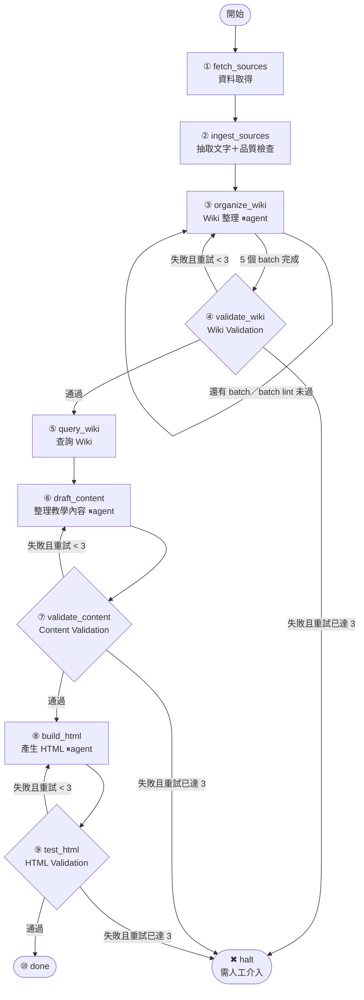

# Workflow：Loop / Graph 設計

> 這份 Workflow 實際用 **LangGraph 1.2.24** 建立並執行（`Workflow/graph.py`）。它不只是一張流程圖。
> 實際執行紀錄見 [execution_log.md](execution_log.md)，由事件紀錄自動產生。

## 1. 架構總覽

| 項目 | 做法 |
|---|---|
| Graph 引擎 | LangGraph `StateGraph`，狀態存在 SQLite checkpoint（`state/checkpoints.sqlite`），可以跨程序暫停和繼續 |
| 程式節點（自動執行） | 資料取得、Ingestion、三個驗證節點、查詢 Wiki、完成／停止 |
| Agent 節點（LLM） | Wiki 整理、教學內容、HTML 生成。用 LangGraph `interrupt()` 暫停，由 Claude Code agent 完成後以 `resume` 繼續 |
| 迴圈上限 | 每個驗證迴圈最多重試 **3 次**（`MAX_RETRIES = 3`），超過就進入 `halt`（需人工介入），不會默默放行 |
| 紀錄 | 每個節點的輸入、輸出、檢查結果、修正說明都寫入 `logs/events.jsonl`；驗證節點的完整結果另存 `logs/*_validation_*.json`、`logs/html_test_*.json` |
| 瀏覽器測試 | Playwright 1.65 驅動本機 Microsoft Edge（headless），開啟 `file://` 的 `index.html` |

**為什麼生成節點是 interrupt？** 這個環境沒有 Anthropic API Key，Graph 無法自己呼叫 LLM。
所以生成交給 agent，而「什麼時候生成、生成後要檢查什麼、失敗要退回哪裡」都由 Graph 決定。
這樣分工也有好處：檢查節點全部是程式，結果可以重現，不受 LLM 自我評分的影響。

## 2. Graph 流程圖（v2，實際編譯出的節點與邊）



`python Workflow/graph.py mermaid` 會輸出 LangGraph 自動畫的原始圖（已存於 [artifacts/graph_mermaid.txt](artifacts/graph_mermaid.txt)）。
節點和條件邊都跟上圖一致，包括 `organize_wiki → organize_wiki` 的自我迴圈。

## 3. 各節點功能

| # | 節點 | 類型 | 輸入 | 輸出 | 會重複執行嗎？ |
|---|---|---|---|---|---|
| ① | `fetch_sources` | 程式 | `config/sources.json`（15 篇來源；run-07 起 urllib 失敗時改用 curl 備援） | `Wiki/raw/Sxx.pdf/txt`、`manifest.json`（HTTP 狀態、大小、SHA-256） | 每篇網路失敗最多重試 3 次；已下載且雜湊相同時使用快取 |
| ② | `ingest_sources` | 程式 | 原始檔 | `Sxx.extracted.txt`（標示頁碼）、`ingest_report.json`、`sources.md` | 每次 run 執行一次 |
| ③ | `organize_wiki` | **agent** | batch 設定、上次驗證的錯誤 | `Wiki/concepts/*.md`、`Wiki/sources/*.md`、`facts.json`、`knowledge_map.md` | **會**：5 個 batch 逐一執行；v2 的 batch lint 沒過就重做同一個 batch；Wiki Validation 失敗時退回這裡修正 |
| ④ | `validate_wiki` | 程式 | 整個 Wiki + 原文 | 通過或失敗、問題清單 | 每次修正後重跑 |
| ⑤ | `query_wiki` | 程式 | `config/slide_outline.json` 的關鍵詞 | `artifacts/query_results.json/.md`（每頁命中的節點） | — |
| ⑥ | `draft_content` | **agent** | 查詢結果 | `artifacts/slide_content.json`（每個重點都標節點與頁碼） | **會**：Content Validation 失敗時退回 |
| ⑦ | `validate_content` | 程式 | 教學內容 + Wiki + facts | 通過或失敗 | 每次修正後重跑 |
| ⑧ | `build_html` | **agent** | `slide_content.json` | `Slides/index.html`（run-07 起由 agent 撰寫的 `tools/render_slides.py` 與 `tools/visuals.html` 產生） | **會**：HTML Validation 失敗時退回 |
| ⑨ | `test_html` | 程式 | `index.html` | 通過或失敗、`screenshots/<run>_<n>/` 截圖 | 每次修正後重跑 |
| ⑩ | `done` / `halt` | 程式 | — | 產生 `execution_log.md` | — |

## 4. 三個檢查節點

### ④ Wiki Validation（`validators/wiki_lint.py`，失敗時退回 ③ 資料整理）

| 代碼 | 對應的作業問題 | 檢查內容 |
|---|---|---|
| W1 | 是否成功取得資料？ | 每篇 HTTP 200、有 SHA-256、抽取字數足夠、預期關鍵字存在 |
| W2 | 來源可追溯 | 每篇來源都有來源頁，標題和網址與設定一致，並列出對應節點 |
| W3 | 是否有重要知識遺漏？ | 核准架構的 20 個節點都存在；5 個主題的必要術語（共 56 個）都有涵蓋 |
| W4 | 格式 | frontmatter 欄位齊全；必要段落都有；「重點」段落標註 `[Sxx p.N]`；引用的來源都已列出 |
| W5 | **不得虛構** | **每條引文都要在原文抽取文字的標示頁碼逐字找到**（比對時忽略空白、斷行連字號、標點、重音；連字遺失的來源會把 fi 摺疊成 f） |
| W6 | 知識關聯 | `[[連結]]`、relations、prerequisites 的目標都存在；關聯型別合法；沒有孤立頁；先備關係沒有循環 |
| W7 | 是否重複？ | 沒有重複的 id 或標題；定義段落用 3-gram Jaccard 比對，0.8 以上視為重複 |
| W8 | 是否矛盾？ | 頁面 `facts` 必須與 `facts.json` 的標準值一致，且標準值都附原文引文；常見誤解只能出現在「常見誤解」段落 |

### ⑦ Content Validation（`validators/content_check.py`，失敗時退回 ⑥ 內容生成）

| 代碼 | 對應的作業問題 | 檢查內容 |
|---|---|---|
| C1 | 結構 | 10–12 張、編號連續、封面在最前、總結在最後、標題不重複、每頁都有重點與來源 |
| C2 | 簡報內容是否有 Wiki 依據？ | 每個重點都標註節點；節點必須出現在 `query_wiki` 對該頁的檢索結果；`cite` 的來源必須屬於該節點；投影片來源欄必須涵蓋所有 cite |
| C3 | 技術描述是否正確？ | AES 輪數、區塊大小、RSA 金鑰長度與 `facts.json` 一致；v2 起**逐一比對 AES 版本與輪數**；常見誤解不得出現 |
| C4 | 技術描述是否正確？ | Caesar、RSA、Diffie–Hellman 範例由程式重新計算；run-04 起，**AES 第 1 輪逐步實例由獨立的 AES 參考實作（`validators/aes_ref.py`）重算每個 4×4 state，包括解密方向** |
| C5 | 教學順序是否適合初學者？ | 每個節點的先備概念必須在同一頁或更早的頁出現（依據知識圖的 prerequisites） |
| C6 | 避免文字堆積 | 每頁最多 4 個重點（總結頁 5 個），每點 60 字以內，每頁合計 200 字以內；名詞小卡每頁最多 5 張、每張 45 字以內 |
| C7 | 名詞先解釋（run-07，使用者回饋） | 依 `config/glossary.json` 的 48 個名詞：名詞第一次出現的那一頁或更早，必須有名詞小卡解釋 |
| C8 | 公式符號要說明（run-07，使用者回饋） | 公式中的每個符號（例如 C、M、e、n）都要有說明；重點或導言裡出現公式時，該頁必須附符號表；run-08 起每個公式都要有可轉成 MathML 的 LaTeX |
| C9 | 圖片只寫名稱（run-07，使用者回饋） | 每張圖要有名稱，且圖名不寫來源或製作方式（例如「依…改繪」「引自」「重算」） |
| C10 | 每個主題的來龍去脈（run-07／09，使用者回饋） | 每章必須包含指定的教學角色，例如對稱式加密章要有「原理」「好處與限制」「現實應用」；run-09 起第 2～6 章的第一張必須是承上啟下的轉場頁（回顧、新問題、預告） |

### ⑨ HTML Validation（`validators/html_test.py`，失敗時退回 ⑧ HTML 生成）

| 代碼 | 對應的作業問題 | 檢查內容 |
|---|---|---|
| H1 | 網頁是否能正常開啟？ | 用 `file://` 開啟，沒有 console error、page error 或載入失敗的資源 |
| H2 | 是否有內容缺失？ | 投影片數量與內容檔一致；每頁的標題、每個重點、每個來源 ID 都在對應的頁面上 |
| H3 | 投影片切換是否正常？ | 測試 → ← 鍵、上一頁／下一頁按鈕、第 1 頁按 ← 不會越界、最後一頁的行為；任何時刻只有一頁可見 |
| H4 | 頁數與進度條 | 頁碼文字和進度條寬度隨切換更新 |
| H5 | 全螢幕 | 按鈕有呼叫 `requestFullscreen`，並記錄 `document.fullscreenElement` 的實際狀態 |
| H6 | 是否有排版錯誤？ | 1280×720 下每頁內容不溢出；390×844（手機）下不出現水平捲動；run-05 起手機上**內容不得與來源欄重疊** |
| H9 | 數學排版（run-08，使用者回饋） | 每個公式都以 MathML 實際排版顯示；畫面文字不得出現 `x^2`、`E_K`、`c_i` 這類未排版寫法 |
| H8 | 名詞先解釋（畫面） | 用實際畫面上的文字（逐個文字節點加分隔）再檢查一次 C7，避免畫面上多出未解釋的名詞 |
| H7 | 互動示範 | Caesar 滑桿 3 組輸入的結果；ECB 圖保留原圖結構、CBC 圖不保留；DH 和 RSA 的數值；v2 起加上 **ECB 圖兩個主要顏色的 WCAG 對比度 ≥ 3:1**；run-04 起加上：**AES 逐步圖解每一步畫面上的 state 與內容檔一致**、Caesar 解密、操作模式分頁一次只**實際顯示**一個 |

## 5. 為什麼這樣設計

1. **先建 Wiki，再查詢，再生成。** 簡報只能使用 `query_wiki` 檢索到的節點（由 C2 強制）。所以每個重點都能追到「節點 → 來源頁 → 原文頁碼」。
2. **檢查一律用程式，不讓 LLM 自己打分數。** 引文必須能在原文逐字找到（W5），數值必須與事實表一致（W8／C3），範例由程式重算（C4）。這三項專門用來防止 LLM 虛構。
3. **失敗只退回造成問題的那一層。** Wiki 錯就改 Wiki，內容錯就改內容，HTML 錯就改 HTML，不必整條重跑。
4. **有重試上限。** 每個迴圈最多重試 3 次。超過就停下來交給人判斷，避免無限迴圈，也避免為了通過而亂改。
5. **先寫檢查規則，再生成。** 每個驗證器都在對應內容產生之前寫好，避免先寫內容、再配合內容調寬規則。

## 6. 實際執行後的修改（v1 → v2）

修改的根據都在 [execution_log.md](execution_log.md) 中。

| 問題（實際發生） | 原本在哪裡發現 | v2 把檢查移到哪裡 | 修改內容 |
|---|---|---|---|
| S04（FIPS 197）PDF 的 fi 連字遺失（specified 變成 specifed）。換三套抽取工具結果都相同，問題在來源檔本身 | ③ `organize_wiki` batch 3：agent 讀原文時才發現。② ingest 只檢查字數和關鍵字，所以放行了 | **② ingest_sources** | ingest 加入連字遺失偵測：S04 有 77 個症狀字並發出警告，其他 11 篇都是 0；Lint 對這類來源把 fi 摺疊成 f 再比對。run-02 的 ingest 確實在一開始就自動標出 S04 |
| 跨頁引文中間夾著 NIST 頁首，導致比對失敗（236 條引文中有 1 條） | ④ `validate_wiki`：5 個 batch **全部寫完**才發現 | **③ 每個 batch 寫完當下**（batch lint） | 新增 `quick_lint`，每個 batch 寫完就檢查該 batch 的 W4/W5，失敗就留在同一個 batch 修正。已用副本驗證能在 batch 5 當下抓到這個錯誤 |
| ECB 示範圖兩色對比只有 1.06:1，肉眼看不出輪廓；DH 表格「K = 18」斷行 | Graph 已經結束（`done`）後，agent **人工看截圖**才發現。⑨ 的自動測試全部通過 | **⑨ test_html 的自動檢查** | H7 加入 WCAG 對比度檢查。run-02 先用**未修改**的 HTML 驗證新檢查能抓到（1.06:1，失敗），接著修正兩次（1.94:1 → 第 3 次通過） |
| 「AES-128 做 12 輪」能通過 C3（12 是合法輪數，但版本錯了） | Graph 之外的 **validator 自我測試**（注入 13 種錯誤，抓到 12 種） | **⑦ validate_content** | C3 改為逐一比對版本與輪數，自我測試變成 13/13 |
| 重跑時要重建 5 個 batch | run-02 設計時發現 | ③ | 增量模式：已存在的節點不重建。LLM Wiki 本來就是持續累積的 |
| 加強後的 C3 把「AES-128 第 1 輪」的序數誤判為輪數（**誤判**，內容其實正確） | ⑦ validate_content（run-04） | ⑦ | C3 排除「第 N 輪」；重跑自我測試仍為 13/13。這是唯一一次判定修改驗證器、不改內容 |
| CSS `display:flex` 蓋過 `hidden`，4 個分頁同時顯示；H7 只看 `hidden` 屬性所以沒抓到 | ⑨ H6 溢出檢查（run-04） | ⑨ | 加入 `[hidden]{display:none!important}`；H7 改為檢查實際顯示（computed display 與高度） |
| 網站（Cloudflare）擋下 Python 的 HTTP 用戶端，網路重試 3 次都一樣 | ① fetch（run-06，只能中止） | ① | 失敗時改用 curl 備援並記錄 `fallback`；ingest 加入 HTML 網頁抽取 |
| 名詞沒先解釋、公式符號沒說明、圖片寫來源、主題擠在一兩頁、Vigenère 沒解釋 | **使用者看完簡報的回饋**（所有檢查都通過） | ⑦ C7–C10、⑨ H8 | 把回饋寫成自動檢查；自我測試加 5 個案例（18/18） |
| query_wiki 用了舊大綱 | run-07 查詢後才發現 | 規劃階段 | 大綱必須在 Wiki 整理結束前定好；重新查詢並記錄 |
| 新檢查的誤判：「輪流」被當成「輪」、「CAESAR」含 AES、相鄰元素文字黏成「公開金鑰」 | ⑦ C7、⑨ H8（run-07） | ⑦⑨ | 修正名詞表 pattern；H8 改為逐個文字節點加分隔再比對 |
| 手機上 10/12 張投影片的內容蓋住來源欄（run-01 就存在） | run-04 結束後**人工看截圖** | **⑨ H6** | 新增「內容不得與來源欄重疊」檢查；run-05 先用未修改的 HTML 確認能抓到，再修正窄螢幕排版 |

## 7. 執行方式

```bash
# 在 Cryptography_Project/Workflow 底下（使用 ../../.venv 的 Python）
python graph.py start  --thread run-03          # 執行：取得 → ingest → 暫停在 organize_wiki
python graph.py resume --thread run-03 --note "做了什麼"   # agent 完成後繼續
python graph.py status --thread run-03          # 查看目前節點與重試次數
python graph.py report                          # 從 events.jsonl 產生 execution_log.md
python validators/wiki_lint.py                  # 單獨執行 Wiki Validation
python validators/content_check.py              # 單獨執行 Content Validation
python validators/html_test.py manual           # 單獨執行 HTML Validation（需要 Edge）
python validators/selftest.py <暫存資料夾>       # 驗證器自我測試（注入 13 種錯誤）
```

## 8. 限制

- 生成節點由 agent 執行，不是 Graph 自動呼叫 LLM API（原因見第 1 節）。
- `query_wiki` 用關鍵詞計分檢索，不是語意檢索。好處是可以重現，缺點是需要在大綱裡寫好關鍵詞。
- W5 只能證明「引文在原文裡」，不能證明「中文敘述完全符合引文的意思」。這部分要靠 C3 事實表、C4 範例重算，以及人工閱讀。
- HTML 的視覺品質（例如美感、對比）只有部分能自動化。run-01 的經驗證明，人工看截圖仍然有必要。
